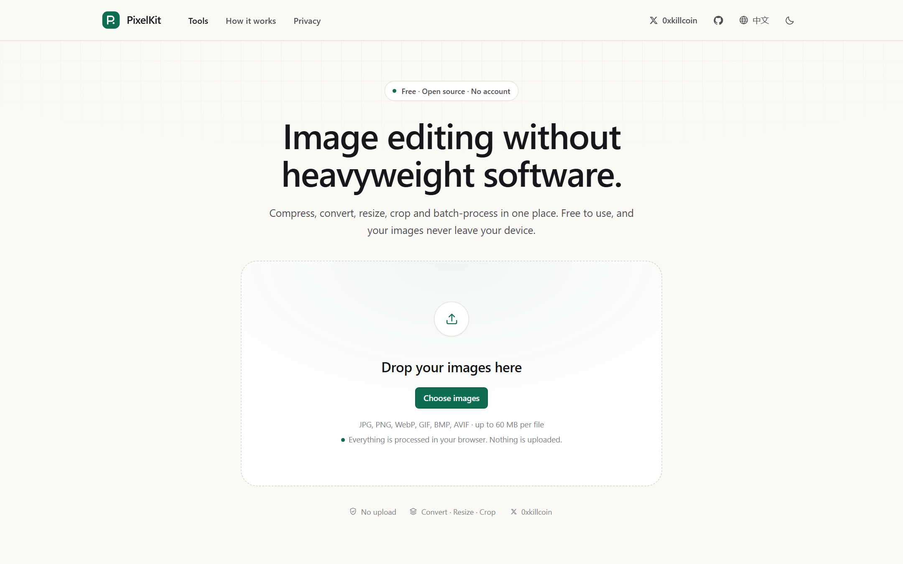
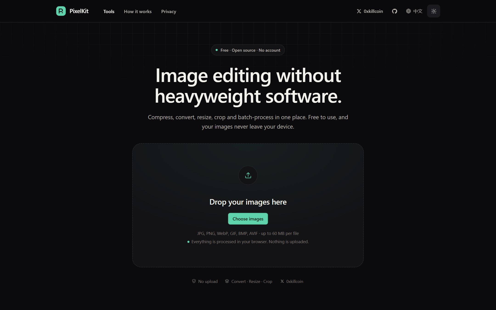
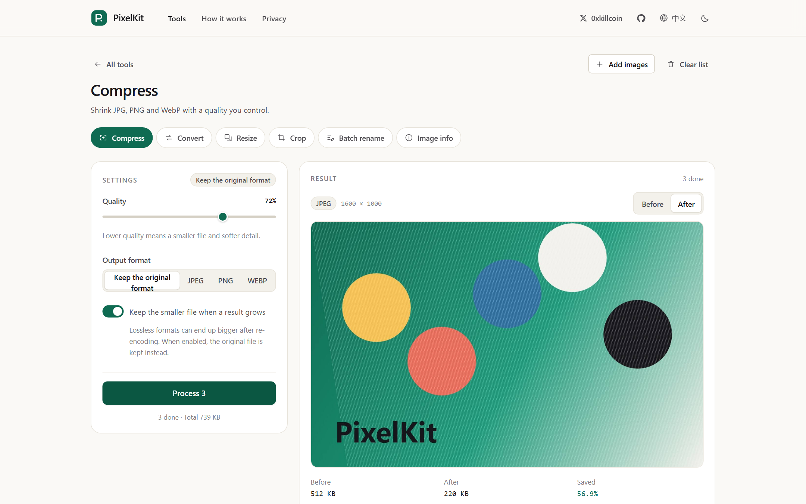
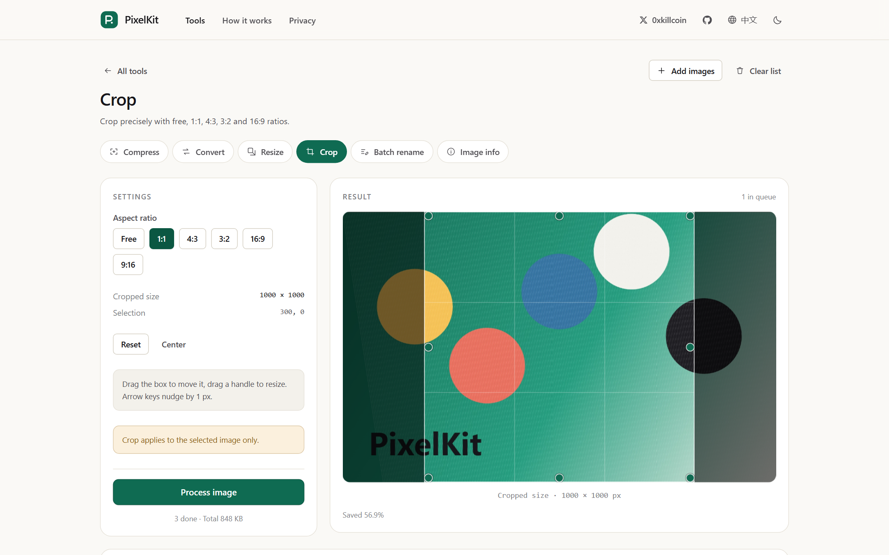
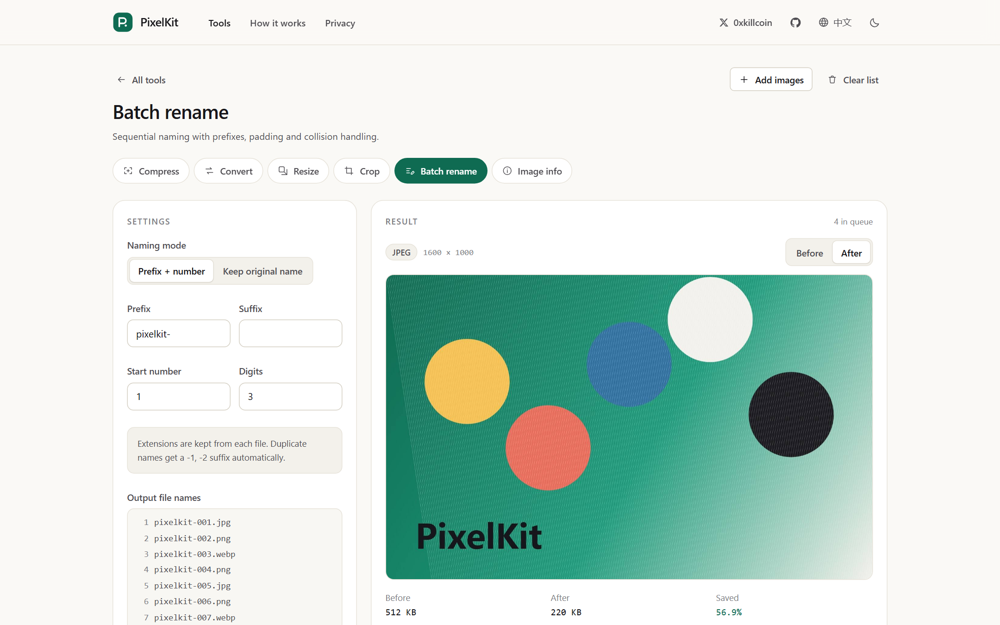
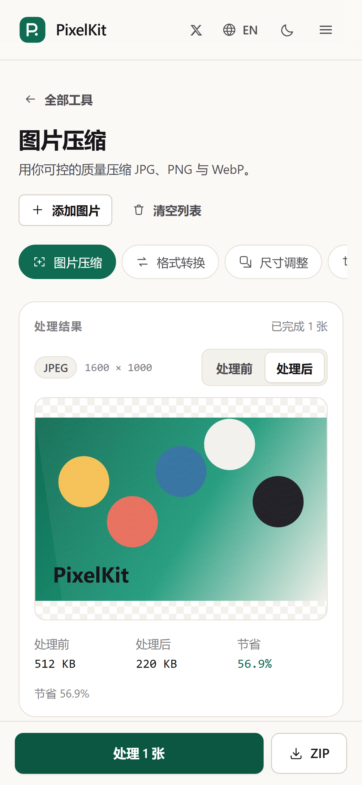
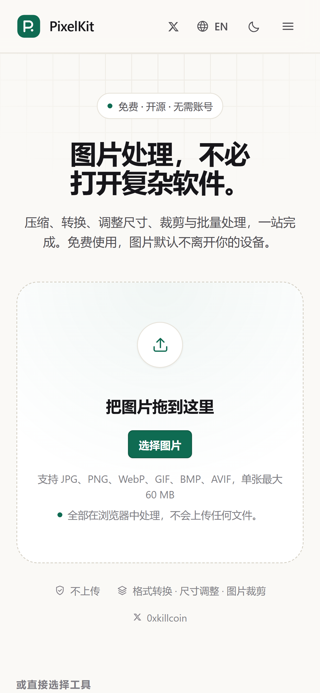

<div align="center">



# PixelKit

**Your Images, Perfected.** · 让图片处理变得简单。

A free, privacy-first image toolkit that runs entirely in your browser.

[](LICENSE)
[](https://github.com/iiiiiiiiiiiiiKK/pixelkit/actions/workflows/ci.yml)
[](https://github.com/iiiiiiiiiiiiiKK/pixelkit/actions/workflows/deploy.yml)
[](#privacy--security)
[](#architecture)

[**Open the app**](https://iiiiiiiiiiiiiKK.github.io/pixelkit/) ·
[中文文档](#中文文档) ·
[How it works](https://iiiiiiiiiiiiiKK.github.io/pixelkit/#/guide) ·
[Privacy note](https://iiiiiiiiiiiiiKK.github.io/pixelkit/#/privacy) ·
[Author on X](https://x.com/0xkillcoin)

</div>

---

## What it is

PixelKit is a small, fast image workbench: **compress, convert, resize, crop, batch rename and inspect** images, all inside the browser tab. No account, no upload, no paid API, no AI service — just the canvas and codec APIs your browser already ships.

It exists because the alternatives are usually one of three things: a marketing page wrapped around a watermark, a desktop application for a five-second task, or a service that quietly uploads your photos to a server you have never heard of.

```text
Drop files  →  pick a tool  →  preview the real byte difference  →  download (or one ZIP)
```

## Screenshots

All screenshots below are captured from the real application by `npm run shots` — no mockups, no invented data.

| Home (light) | Home (dark) |
| --- | --- |
|  |  |

| Compress a batch | Crop with a 1:1 selection |
| --- | --- |
|  |  |

| Batch rename | iPhone (390 × 844, WebKit) |
| --- | --- |
|  |  |

## Features

| Tool | What it does | Honest constraints it shows in the UI |
| --- | --- | --- |
| **Compress** | Quality slider (5–100 %), optional format switch, real before/after byte comparison, batch + ZIP | PNG is lossless, so the slider is disabled for it and the UI says so; a result that grows can keep the original file instead |
| **Convert** | JPG ↔ PNG ↔ WebP re-encoded by the browser, transparent areas flattened onto a chosen colour for JPEG | Only formats the browser can *actually* encode are offered — verified by encoding a test pixel, not assumed from the file extension |
| **Resize** | Exact pixels, percentage (1–400 %), locked aspect ratio, size presets | 1 – 16384 px, validated per field, same target applied to the whole batch |
| **Crop** | Draggable crop box with 8 handles, free + 1:1 / 4:3 / 3:2 / 16:9 / 9:16, rule-of-thirds guides, keyboard nudge | Applies to the selected image only, and the UI says so instead of silently cropping the batch |
| **Batch rename** | Prefix + zero-padded numbering (start + digits), or keep the original name, live preview of every output name | Duplicate names get `-1`, `-2` suffixes; extensions follow the real file format |
| **Image info** | Real format (from magic bytes), real pixel size, megapixels, file size, and the size difference after processing | Metadata that cannot be read is not invented — no guessed camera model or capture date |

Everything else that a batch workflow needs is there too: drag & drop anywhere on the drop zone, per-file status and progress, retry a single failure, remove one file, clear the queue, download everything as a ZIP whose entry names match the preview, and a session history table.

## Deliberately not included

PixelKit is an image utility, not an editor. There is no layer system, no filters, no AI background removal, no watermark, no cloud storage and no "pro" upsell. Anything that would need a server, an API key or a subscription is out of scope by design — that is what keeps the privacy claim true and the bundle 115 kB gzipped.

## Quick start

```bash
git clone https://github.com/iiiiiiiiiiiiiKK/pixelkit.git
cd pixelkit
npm install
npm run dev          # http://localhost:5180
```

Requirements: Node.js ≥ 20.19. No environment variables, no database, no API keys — `.env` does not exist because nothing needs one.

### Scripts

| Command | What it does |
| --- | --- |
| `npm run dev` | Vite dev server on port 5180 |
| `npm run build` | Typecheck, then production build into `dist/` |
| `npm run preview` | Serve the production build locally |
| `npm run check` | Lint + typecheck + unit tests + build (the full gate) |
| `npm run lint` | ESLint (flat config, TypeScript + React hooks rules) |
| `npm run typecheck` | `tsc --noEmit` across app, unit tests and e2e specs |
| `npm run test` | Vitest unit suite |
| `npm run test:e2e` | Generates image fixtures, then Playwright: Chromium + WebKit (iPhone viewport) |
| `npm run verify:live` | Drives the deployed site in a real browser and fails on any console or CSP error |
| `npm run shots` | Re-captures the README screenshots into `docs/screenshots/` |

## Architecture

```text
src/
├── engine/                 # pure processing core — no React, no JSX
│   ├── formats.ts          # magic-byte sniffing, mime/extension maps, size limits
│   ├── geometry.ts         # resize maths, presets, crop ratio presets
│   ├── render.ts           # canvas rendering, stepped downscale, encode verification
│   ├── pipeline.ts         # decode → crop → resize → encode, one place
│   ├── processor.worker.ts # worker entry (OffscreenCanvas + createImageBitmap)
│   ├── client.ts           # worker pool facade, encoder detection, file validation
│   ├── rename.ts           # naming rules, sanitising, collision resolution
│   ├── queue.ts            # bounded-concurrency task queue with cancel
│   └── zip.ts              # fflate ZIP assembly, entry de-duplication
├── workspace/              # queue state, per-tool settings, crop maths + panels
├── components/             # design-system primitives, header, footer, drop zone
├── pages/                  # home, workspace, guide, privacy
├── i18n/                   # en + zh dictionaries, typed against each other
└── styles.css              # design tokens (light/dark) + component styles
```

### How one image is processed

1. **Validation** — the first 512 bytes are read to detect the real container (`detectInputFormat`). A `.png` that is really a JPEG is treated as a JPEG; a text file renamed to `.jpg` is rejected with a reason, not a crash.
2. **Queueing** — files go into a `TaskQueue` with concurrency 1. One image at a time keeps a phone responsive and keeps peak memory at a single decoded bitmap.
3. **Worker hop** — `client.processImage` posts `{ blob, ops }` to the worker. If the browser has no `Worker` or no `OffscreenCanvas` inside it (WebKit before 16.4), the same pipeline runs on the main thread instead and the UI keeps working.
4. **Decode** — `createImageBitmap(blob, { imageOrientation: 'from-image' })` so EXIF-rotated phone photos come out upright.
5. **Render** — one canvas at the target size; huge downscales are done in progressive halvings so edges stay crisp instead of aliasing.
6. **Encode** — `convertToBlob` / `toBlob`, then the returned `blob.type` is compared with the requested MIME. If the browser silently fell back to PNG, PixelKit reports an error instead of shipping a mislabelled file.
7. **Result** — the worker returns the blob plus its real dimensions and a transparency flag sampled from a downscaled copy; the UI revokes the previous object URL and shows the true byte delta.

State lives in React context and memory only. Object URLs are revoked when an item is removed, replaced or the workspace unmounts.

## Privacy & security

- **No upload.** There is no `fetch`, `XMLHttpRequest`, `WebSocket` or beacon in the processing path, and no backend to talk to. You can disconnect the network after the page loads and keep working.
- **No tracking.** No analytics, no ads, no cookies, no third-party fonts or icons, no remote images. The only files the page loads come from its own origin.
- **No persistence of image data.** `localStorage` holds two preference keys only: `pixelkit.lang` and `pixelkit.theme`. Image binaries never touch storage; the session history lives in memory and disappears on reload.
- **Strict CSP.** The production HTML ships a `Content-Security-Policy` meta tag: `default-src 'self'`, scripts and connections same-origin only, `worker-src 'self' blob:`, `object-src 'none'`, `form-action 'none'`. The one relaxed directive is `style-src 'unsafe-inline'`, which React inline styles require.
  GitHub Pages cannot send response headers, so `frame-ancestors` / `X-Frame-Options` / `X-Content-Type-Options` are not enforceable there — that is a platform limit, stated here rather than hidden.
- **Resource limits.** 60 MB per file, 200 MP decoded, 100 MP per output, 60 images per batch. Each limit has a human-readable error message instead of a frozen tab.
- **Three runtime dependencies.** `react`, `react-dom` and `fflate` — all MIT, all bundled. No post-install scripts. See [SECURITY.md](SECURITY.md) for the threat model.

## Testing

What actually ran, on the machine this was built on (Windows 11, Node 24, Chromium 1248 / WebKit 2370 via Playwright):

| Gate | Command | Result |
| --- | --- | --- |
| ESLint | `npm run lint` | **0 problems** |
| TypeScript | `npm run typecheck` | **0 errors** (app, unit tests, e2e specs) |
| Unit tests | `npm run test` | **80 passed** in 8 files |
| E2E — Chromium | `npm run test:e2e` | **37 passed** |
| E2E — WebKit, iPhone 13 viewport | `npm run test:e2e` | **4 passed** |
| Production build | `npm run build` | **success** — 337 kB JS (107 kB gzip), 37 kB CSS (8 kB gzip), 4 kB worker |

The unit suite covers the parts where a silent bug would corrupt output: format sniffing from magic bytes, byte formatting, resize maths and clamping, rename padding and collisions, crop rectangle geometry with and without an aspect ratio, ZIP entry de-duplication, the task queue (concurrency, cancel, resume, error recovery) and translation completeness (both dictionaries have every key, no empty strings, matching `{placeholders}`).

The end-to-end suite drives the real app in a real browser and checks *outcomes*, not pixels on screen:

- a compressed JPEG is downloaded and its bytes are compared with the source — it is smaller, and its container is verified from the file signature;
- PNG → WebP and PNG → JPEG downloads are re-decoded in the browser to prove the size actually changed to 800 × 500, 200 × 150 or 800 × 800 as requested;
- crop handles are dragged with the mouse, and the exported pixels must equal the selection that was on screen;
- a batch ZIP is unzipped in Node (`fflate`) and the entry names must match the rename preview exactly;
- duplicate names produce `-1` suffixes; renaming is byte-identical to the source file;
- a text file dropped into a PDF-named `.jpg` batch is rejected with a visible reason and never enters the queue;
- a reload starts from an empty queue and `localStorage` is empty unless the user changed a preference;
- the iPhone project checks no horizontal overflow, that tap targets are ≥ 32 px, that the preview stacks above the settings, and that a photo can be processed with the mobile action bar.

If a browser could not be tested for real, it is listed as untested below instead of being claimed as passing.

### Continuous integration and the live site

Every push to `main` runs the same gates on GitHub's Ubuntu runners. The run for the current `main` passed all of them, including a full Playwright run (Chromium + WebKit) against a fresh `npm ci` install — not only a local result.

After deployment, `npm run verify:live` drives the **production** bundle at <https://iiiiiiiiiiiiiKK.github.io/pixelkit/> and asserts the things that can only break after a build:

| Check | Result |
| --- | --- |
| Home responds 200, title, h1, six tool entries, stylesheet applied | pass |
| Strict CSP meta tag present, **no CSP violations, no console errors** | pass |
| Author X link resolves to `https://x.com/0xkillcoin` | pass |
| Upload → compress → download: real JPEG bytes, smaller than the 512 KB source (225 KB), correct file name | pass |
| Upload → resize to 640 px → download: decodes at exactly **640 × 400** | pass |
| Language toggle switches the UI to Chinese; theme toggle switches to dark | pass |
| iPhone 13 viewport: no horizontal overflow, Chinese default, no page errors | pass |

**21/21 checks passed** against the live site.

## Browser support

| Browser | Status |
| --- | --- |
| Chrome / Edge (Chromium) | Fully tested (E2E) — Web Worker + OffscreenCanvas path |
| Safari / iOS Safari ≥ 16.4 | Same engine, WebKit-tested at an iPhone 13 viewport; worker path with OffscreenCanvas |
| Safari < 16.4, older WebKit | Supported through the main-thread fallback (verified manually with the bundled WebKit build, which has no `OffscreenCanvas`); processing blocks the UI while it runs |
| Firefox | Expected to work (Worker + OffscreenCanvas since FF 105) but **not covered by an automated run in this repo** — see “Known limitations” |

Decoding is delegated to the browser, so what you can open depends on it: JPG, PNG, WebP, GIF (first frame), BMP and AVIF are offered; HEIC from iPhones is detected and explained rather than silently failing.

## Deployment

The deployed site is a static bundle on **GitHub Pages**:

**https://iiiiiiiiiiiiiKK.github.io/pixelkit/**

`.github/workflows/deploy.yml` builds on every push to `main`, runs lint/typecheck/unit tests, then publishes `dist/` with `actions/deploy-pages`. The only deployment-specific setting is the base path:

```bash
GITHUB_PAGES=true npm run build     # emits asset URLs under /pixelkit/
```

Deploy your own copy:

1. Fork or clone the repository.
2. **Settings → Pages → Build and deployment → Source: GitHub Actions.**
3. Push to `main`. The workflow publishes the site; the first run takes about a minute.
4. Using a different repository name? Set `base` in `vite.config.ts` to `/<your-repo>/`.

Any static host works the same way (`dist/` is self-contained): Cloudflare Pages (`npm run build`, output `dist`), Netlify, Vercel or an S3 bucket. PixelKit uses hash routing (`/#/tool/crop`), so no SPA rewrite rules are needed anywhere.

## Known limitations

These are real, and none of them are hidden behind vague wording in the UI:

1. **PNG cannot be meaningfully “compressed”.** Re-encoding a PNG through a canvas is lossless but rarely smaller — often bigger. PixelKit says so, disables the quality slider for PNG, and offers “keep the smaller file”. Convert to WebP or JPEG for real savings.
2. **JPEG has no alpha channel.** Transparent pixels are composited onto a colour the user picks; the UI warns before you press the button.
3. **HEIC/HEIF is not decodable** in most browsers. It is detected by its `ftyp` brand and reported with a hint to export as JPG.
4. **Animated images lose animation.** GIF/WebP animation is processed as a single frame (stated in the convert panel).
5. **Crop is single-image.** Batch-cropping with a per-image region is a different UX; today the crop tool acts on the selected file and the UI says so.
6. **No service worker.** The first load needs a network connection; after that the page works offline until it is closed.
7. **No EXIF/XMP display or editing.** Only facts that can be read reliably are shown.
8. **Firefox is not covered by the automated suite** in this repository (Chromium + WebKit are). The code paths it would use (Worker + OffscreenCanvas) are exercised by Chromium.
9. **GitHub Pages cannot set security headers** — the CSP ships as a meta tag, and `frame-ancestors` cannot be expressed that way.
10. **No undo stack.** Settings can be reset per tool; processed files are re-generated rather than versioned.

## Roadmap

Ideas that fit the constraints (client-side only, no accounts):

- AVIF/JPEG XL output where the browser can encode it (detection is already in place).
- Per-image crop regions for batch cropping.
- Drag-to-reorder for the output sequence and per-file parameter overrides.
- A service worker for a proper offline first load.
- Optional corner-radius / basic geometry transforms that stay honest about being lossy or not.

## Contributing

Bug reports, translations and pull requests are welcome — please read [CONTRIBUTING.md](CONTRIBUTING.md) first. The short version: no network calls with user data, no fake features, every user-visible string goes through `src/i18n/dict.ts`, and pure logic needs a unit test.

## License

[MIT](LICENSE) © 2026 [0xKill](https://x.com/0xkillcoin)

Built with React 19, TypeScript, Vite 8, Tailwind CSS 4 and [fflate](https://github.com/101arrowz/fflate). No backend, no database, no third-party runtime assets.

---

## 中文文档

<div align="center">



</div>

**PixelKit** 是一个免费、开源、隐私优先的在线图片处理工具箱。所有处理都在你的浏览器里完成：不需要注册，不上传图片，不依赖付费接口或 AI 服务。

### 它能做什么

| 工具 | 功能 | 界面里如实说明的限制 |
| --- | --- | --- |
| **图片压缩** | 质量滑块（5–100%）、可选输出格式、处理前后真实体积对比、批量处理 | PNG 是无损格式，质量参数对它无效，界面会直接告诉你可以改用 WebP/JPEG；如果结果反而变大，可以自动保留原图 |
| **格式转换** | JPG / PNG / WebP 之间真实重新编码；转为 JPEG 时可选择透明区域的填充色 | 只提供浏览器**确实能编码**的格式（会先编码一个测试像素来检测，而不是看扩展名猜） |
| **尺寸调整** | 精确像素、百分比（1–400%）、锁定宽高比、常用尺寸预设 | 1–16384 像素，逐项校验，整批应用同一目标尺寸 |
| **图片裁剪** | 可拖动的裁剪框（8 个控制点）、自由 / 1:1 / 4:3 / 3:2 / 16:9 / 9:16、三分线参考、方向键微调 | 只对当前选中的图片生效，界面会明确提示，不会偷偷裁剪整批 |
| **批量重命名** | 前缀 + 补零编号（起始值与位数可调），或保留原文件名，实时预览全部输出文件名 | 重名自动追加 `-1`、`-2`；扩展名跟随真实格式 |
| **图片信息** | 真实格式（按文件头判断）、真实尺寸、像素量、体积，以及处理后的体积差异 | 读不到的元数据不会编造——不猜测相机型号或拍摄时间 |

此外还有：整页拖放上传、单张状态与进度、失败重试、单张移除、清空队列、ZIP 打包下载（压缩包内文件名与预览一致），以及只在当前页面保留的处理记录。

**刻意不做的功能**：图层、滤镜、AI 抠图、水印、云存储、付费升级。任何需要服务器、密钥或订阅的功能都不在范围内——这正是隐私承诺能够成立、打包体积只有 115 kB（gzip）的原因。

### 本地运行

```bash
git clone https://github.com/iiiiiiiiiiiiiKK/pixelkit.git
cd pixelkit
npm install
npm run dev          # 打开 http://localhost:5180
```

需要 Node.js ≥ 20.19。项目没有环境变量、数据库或密钥，因此也不存在 `.env` 文件。

### 测试与质量

在本机构建时实际执行的结果（Windows 11 / Node 24 / Playwright Chromium + WebKit）：

| 检查项 | 命令 | 结果 |
| --- | --- | --- |
| ESLint | `npm run lint` | **0 问题** |
| TypeScript 类型检查 | `npm run typecheck` | **0 错误** |
| 单元测试（Vitest） | `npm run test` | **80 个全部通过**（8 个文件） |
| 端到端（Chromium） | `npm run test:e2e` | **37 个全部通过** |
| 端到端（WebKit / iPhone 13 视口） | `npm run test:e2e` | **4 个全部通过** |
| 生产构建 | `npm run build` | **成功**：337 kB JS（gzip 107 kB）、37 kB CSS、4 kB Worker |

端到端测试不只是"页面能打开"，而是验证真实结果：下载压缩后的 JPEG 并比对字节数；把转换、缩放、裁剪的结果重新解码，确认尺寸确实是 800×500、200×150、800×800；用鼠标真实拖动裁剪控制点，导出的像素必须等于屏幕上显示的选区；把 ZIP 解压后检查内部文件名与重命名预览完全一致；把文本文件伪装成图片混入队列，确认被拒绝并给出原因；刷新页面后确认队列为空且没有写入任何图片数据；在 iPhone 视口下确认没有横向溢出、可点击区域够大、预览排在参数之前。

### 隐私与安全

- **不上传**：处理链路上没有任何 `fetch`、`XHR`、`WebSocket` 或信标请求，也没有可供上传的后端。页面加载完成后即使断网也能继续使用。
- **不追踪**：没有统计脚本、广告、Cookie、第三方字体或图标 CDN。
- **不持久化图片**：`localStorage` 里只有两个偏好键（语言与主题）；图片数据从不写入任何存储，处理记录只存在于当前标签页的内存中。
- **严格 CSP**：生产 HTML 内嵌 `Content-Security-Policy`，脚本与网络请求仅限同源，Worker 仅限 self/blob，禁用 object 与表单提交。GitHub Pages 无法发送响应头，因此 `frame-ancestors` 等指令在该平台不可用——这是平台限制，此处如实说明。
- **资源上限**：单文件 60 MB、解码 200 MP、单张输出 100 MP、单批 60 张，每个限制都有清晰的提示，而不是让页面卡死。
- **运行时依赖只有三个**：React、React DOM、fflate（均为 MIT）。

### 在线地址

**https://iiiiiiiiiiiiiKK.github.io/pixelkit/**

部署方式是 GitHub Pages + GitHub Actions：推送到 `main` 后自动执行 lint、类型检查、单元测试与构建，再发布 `dist/`。CI 在 GitHub 的 Ubuntu runner 上完整通过，包括一次真实的 Playwright 测试（Chromium + WebKit）。

部署完成后，`npm run verify:live` 会用真实浏览器访问**线上生产版本**并逐项校验：首页与六个工具入口、CSP 是否生效且无违规、作者 X 链接、上传后压缩并下载（真实字节且小于原图）、缩放到 640 像素后解码确认为 640×400、中英文与深浅色切换、iPhone 视口无横向溢出——**21 项检查全部通过**。

自建部署只需在仓库的 **Settings → Pages** 里把来源设为 GitHub Actions，并在构建时指定子路径：

```bash
GITHUB_PAGES=true npm run build    # 资源路径变为 /pixelkit/
```

Cloudflare Pages、Netlify、Vercel、对象存储等静态托管同样可用（产物 `dist/` 自包含）。项目使用 hash 路由（`/#/tool/crop`），因此不需要任何 SPA 重写规则。

### 已知限制

1. **PNG 无法真正"压缩"**：无损重新编码往往体积不变甚至变大，界面会提示改用 WebP/JPEG，并提供"保留较小文件"。
2. **JPEG 没有透明通道**：透明像素会合成到用户选择的底色，并按提示告知。
3. **HEIC/HEIF 多数浏览器无法解码**：会被识别并提示先导出为 JPG。
4. **动图只处理第一帧**（GIF/WebP 动图）。
5. **裁剪只针对单张图片**，不支持"每张图不同区域"的批处理。
6. **没有 Service Worker**：首次打开需要网络，之后直到关闭页面都可离线使用。
7. **不读取也不修改 EXIF/XMP**，只展示能可靠读到的信息。
8. **本仓库的自动化测试未覆盖 Firefox**（覆盖了 Chromium 与 WebKit）。
9. **GitHub Pages 无法设置安全响应头**，CSP 以 meta 标签形式提供。
10. **没有撤销栈**：每个工具支持重置参数，结果是重新生成的，而不是版本化的。

### 参与贡献

欢迎提交 issue、翻译和 PR，请先阅读 [CONTRIBUTING.md](CONTRIBUTING.md)。简要规则：不得引入任何携带用户数据的网络请求，不得添加虚假功能，所有界面文案必须走 `src/i18n/dict.ts`（中英双语、类型互校），纯逻辑必须有单元测试。

### 许可证

[MIT](LICENSE) © 2026 [0xKill](https://x.com/0xkillcoin)

作者：[@0xkillcoin](https://x.com/0xkillcoin)
